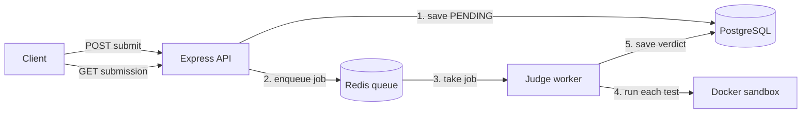

# Code Judge

A mini online judge: submit code in the browser, run it in sandboxed Docker containers, get live verdicts.

🚧 Work in progress.

## How the sandbox works

Every submission runs in a throwaway Docker container with:
- No network access (`--network none`)
- 128 MB memory cap, no swap
- Half a CPU core and a 64-process limit (blocks fork bombs)
- Read-only filesystem, all Linux capabilities dropped
- A hard time limit enforced from the host
- Seed sample problems: `npx prisma db seed`

## Verdicts

| Verdict | Meaning |
|---|---|
| ACCEPTED | All test cases passed |
| WRONG_ANSWER | Output differed from the expected output |
| TIME_LIMIT_EXCEEDED | Ran longer than the problem's limit |
| MEMORY_LIMIT_EXCEEDED | Used more memory than the limit |
| OUTPUT_LIMIT_EXCEEDED | Printed more than 64 KB |
| RUNTIME_ERROR | Crashed or exited with an error |
| INTERNAL_ERROR | The judge itself failed |

Hidden test cases are never revealed. Details are only shown for sample cases.

## Running locally

1. Start the database and Redis: `docker compose up -d`
2. Copy `server/.env.example` to `server/.env` and set `JWT_SECRET`
3. `cd server && npm install && npx prisma migrate dev`
4. Seed sample problems: `npx prisma db seed`
5. Start the API: `npm run dev`
6. In another terminal, start the judge worker: `npm run worker`

## Architecture

