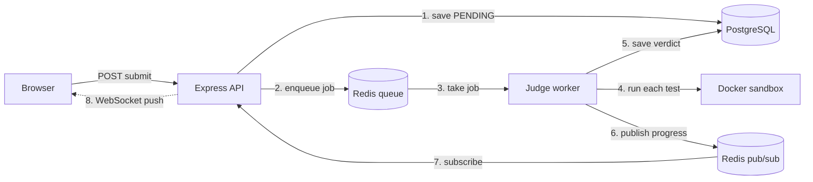

# Code Judge

A mini online judge: submit code in the browser, run it in sandboxed Docker containers, get live verdicts.

🚧 Work in progress.

## Features
- Browse problems and solve them in a Monaco code editor
- Code runs in locked-down Docker containers (no network, memory/CPU/time limits)
- Live verdict updates over WebSockets, with per-test progress
- Hidden test cases are never revealed
- Job queue (Redis + BullMQ) with a separate judge worker
- Submission history that updates live, with a detail page to review (and reload) your code
- Admin page to create and delete problems, with a Markdown preview
- Leaderboard ranked by problems solved, with profile pages (stats, progress, 30-day activity)
- Solved/attempted marks and acceptance rates on the problem list

## How the sandbox works

Every submission runs in a throwaway Docker container with:
- No network access (`--network none`)
- 128 MB memory cap, no swap
- Half a CPU core and a 64-process limit (blocks fork bombs)
- Read-only filesystem, all Linux capabilities dropped
- A hard time limit enforced from the host
- Seed sample problems: `npx prisma db seed`

## Verdicts

| Verdict | Meaning |
|---|---|
| ACCEPTED | All test cases passed |
| WRONG_ANSWER | Output differed from the expected output |
| TIME_LIMIT_EXCEEDED | Ran longer than the problem's limit |
| MEMORY_LIMIT_EXCEEDED | Used more memory than the limit |
| OUTPUT_LIMIT_EXCEEDED | Printed more than 64 KB |
| RUNTIME_ERROR | Crashed or exited with an error |
| INTERNAL_ERROR | The judge itself failed |

Hidden test cases are never revealed. Details are only shown for sample cases.

## Running locally

1. Start the database and Redis: `docker compose up -d`
2. Copy `server/.env.example` to `server/.env` and set `JWT_SECRET`
3. `cd server && npm install && npx prisma migrate dev`
4. Seed sample problems: `npx prisma db seed`
5. Start the API: `npm run dev`
6. In another terminal, start the judge worker: `npm run worker`
7. Optional: open http://localhost:5000/live/ to watch verdicts update live
8. Start the React app: `cd client && npm install && npm run dev` (opens on http://localhost:5173)

## Architecture


## Testing

```bash
cd server
docker exec code-judge-db createdb -U judge codejudge_test   # once
npm run test:unit      # judging logic, no dependencies
npm run test:sandbox   # security limits of the Docker sandbox (needs Docker)
npm run test:api       # API tests against a separate test database (needs Postgres and Redis)
```

The sandbox tests verify that submitted code has no network access, a read-only filesystem, runs as an unprivileged user, and is stopped by time, memory and output limits. API tests run against a dedicated `codejudge_test` database and a separate queue, so they never touch development data.

## Run everything with Docker

Requires Docker (with Compose). No Node installation needed.

```bash
cp .env.example .env          # then edit the two values
docker pull python:3.12-slim  # the image submissions run in
docker compose -f docker-compose.prod.yml up -d --build
docker compose -f docker-compose.prod.yml run --rm migrate npx prisma db seed
```

Open http://localhost:8080. To make yourself an admin after registering:

```bash
docker compose -f docker-compose.prod.yml run --rm migrate node scripts/make-admin.js yourusername
```

> **Security note:** the judge worker starts sandbox containers through the host's Docker
> socket, which is equivalent to root access on that host. Only run this on a machine you
> are comfortable dedicating to the job, and never expose it publicly without hardening.