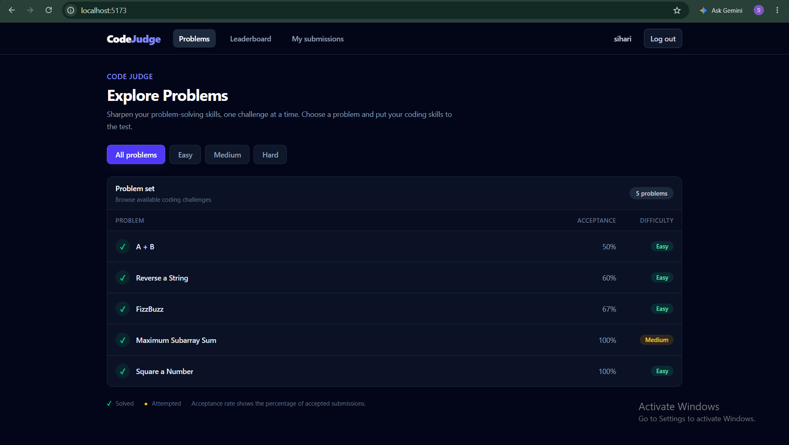
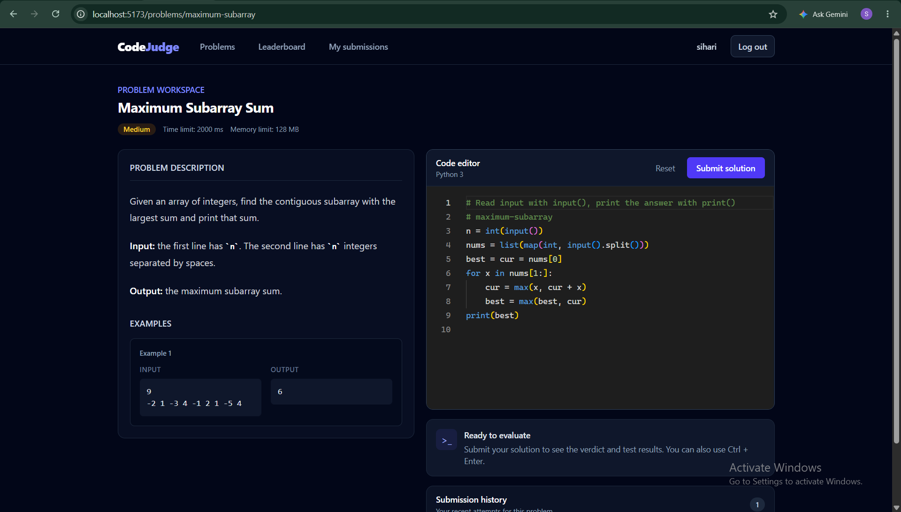
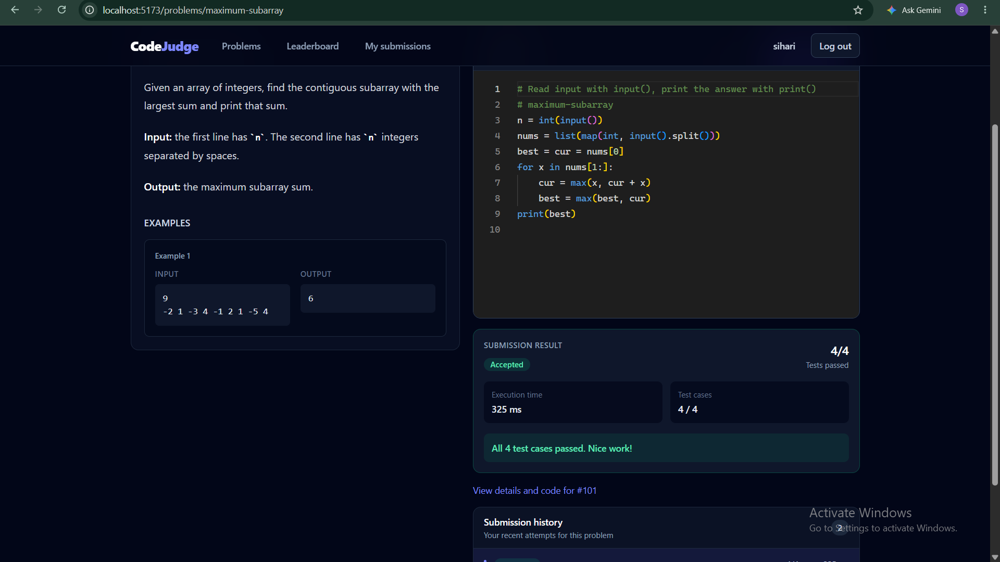
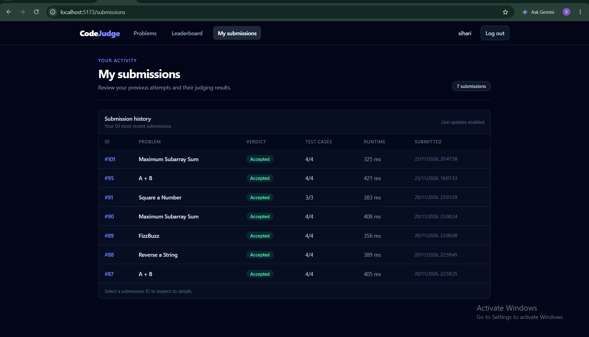
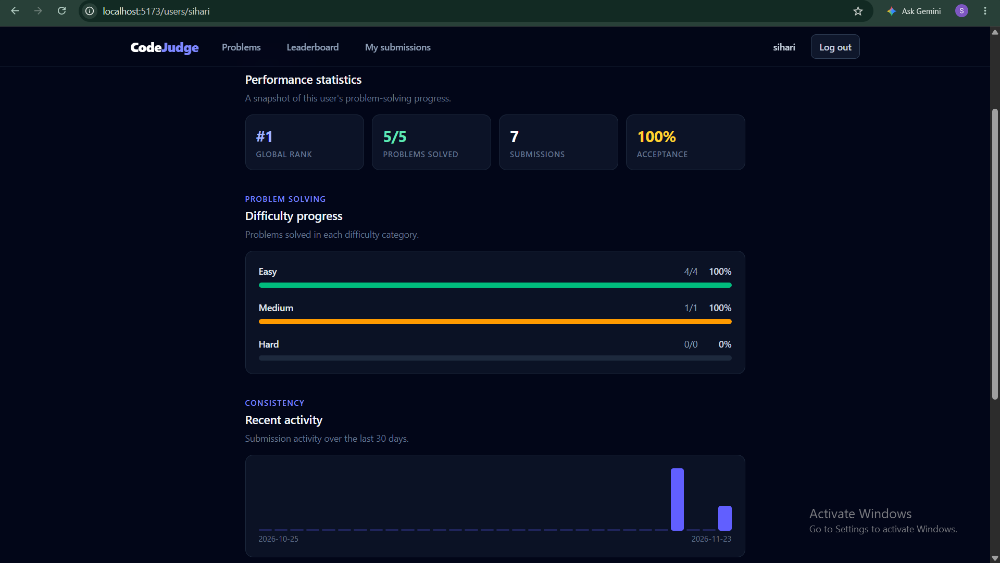
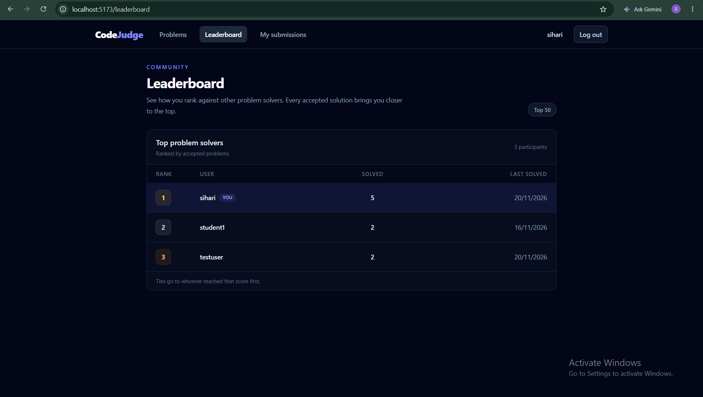
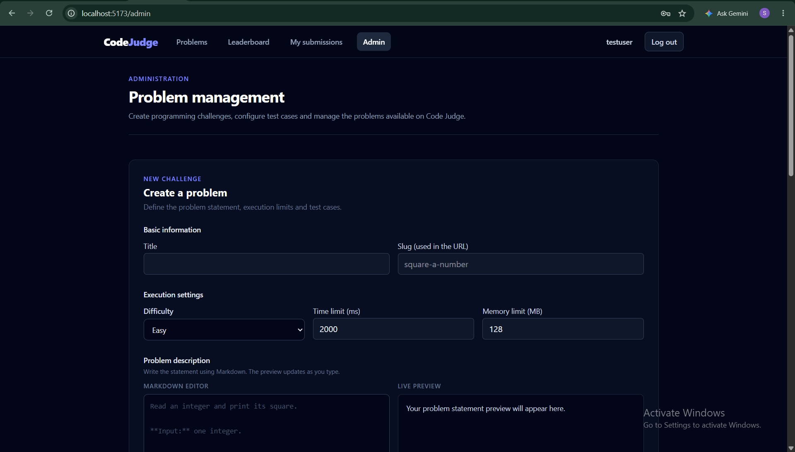
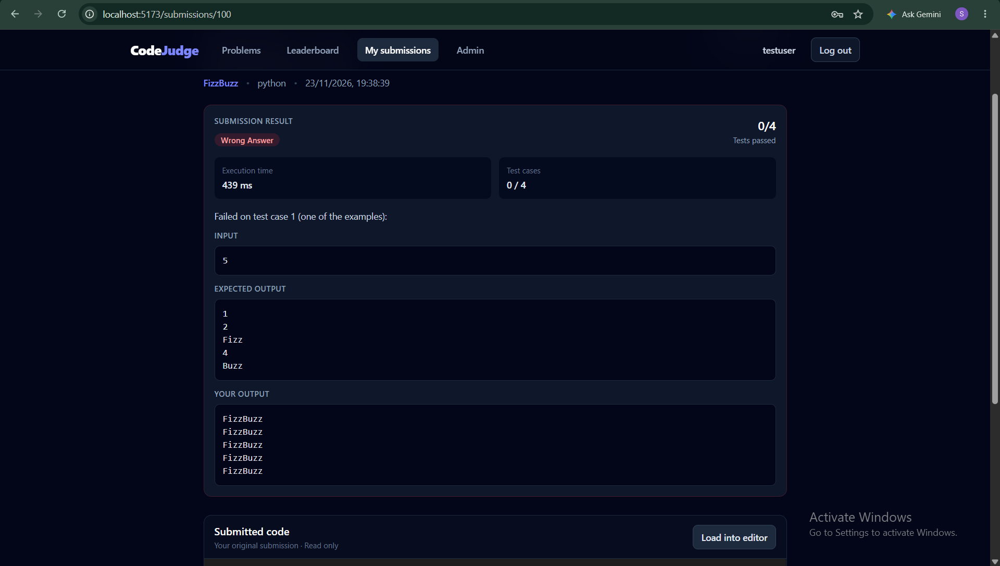
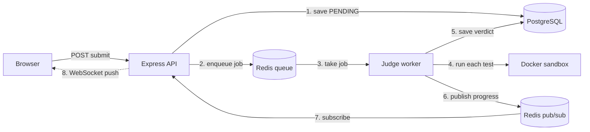
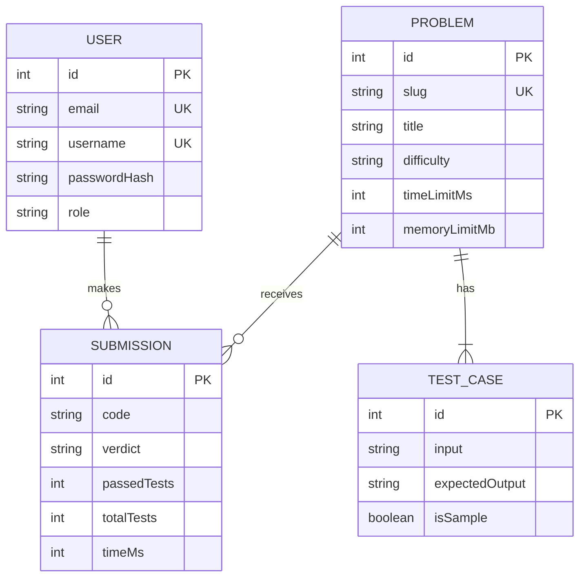

# Code Judge


**Code Judge** is a full-stack online programming judge inspired by platforms like LeetCode and Codeforces. It allows users to solve programming problems, submit Python solutions, and receive real-time judging results through an interactive coding environment.

Built with React, Node.js, PostgreSQL, Redis, and Docker, the platform uses an asynchronous judging architecture to execute untrusted code in isolated containers, enforce resource limits, and protect hidden test cases.


## Screenshots

### Problems and coding workspace

| Problems | Problem workspace |
|---|---|
|  |  |

### Submissions and verdicts

| Accepted verdict | Submission history |
|---|---|
|  |  |

### User profiles and rankings

| User profile | Leaderboard |
|---|---|
|  |  |

### Administration



<details>
<summary>View additional problem detail screen</summary>



</details>

## Features

- Problem list with difficulty filter, solved/attempted marks and acceptance rates
- Monaco code editor (the VS Code editor) with Markdown problem statements
- **Live verdicts over WebSockets**: queued, per-test progress, final result
- Verdicts: Accepted, Wrong Answer, Time / Memory / Output Limit Exceeded, Runtime Error
- **Hidden test cases are never revealed**, even to someone inspecting network traffic
- Submission history with a code viewer and "load into editor"
- Leaderboard and public profiles (progress by difficulty, 30-day activity chart)
- Admin page to create and delete problems, with a Markdown preview
- Optional invite-only registration, login rate limiting and role-based access

## How a submission flows through the system



1. The API validates the request, stores the submission as `PENDING`, puts a job holding only
   the submission id on a queue, and returns `202 Accepted` immediately.
2. A separate **worker** process takes the job, marks it `JUDGING`, and loads the problem.
3. For each test case it starts a throwaway container, feeds it the input, enforces the
   limits, and compares the normalised output. It stops at the first failure.
4. The verdict is saved, and progress events are published through Redis.
5. The API forwards each event to the submitting user's private Socket.IO room.
6. If the socket drops, the client re-fetches over REST. REST is the source of truth,
   and sockets are only for speed.

## Data model



## Tech stack

| Layer | Technology |
|---|---|
| Frontend | React, Vite, Tailwind CSS, React Router, Monaco editor, Socket.IO client |
| API | Node.js, Express, Zod validation, JWT authentication, Socket.IO |
| Database | PostgreSQL with Prisma (plus raw SQL for the leaderboard) |
| Queue | Redis with BullMQ, a separate worker process |
| Sandbox | Docker containers with strict resource and privilege limits |
| Tests and CI | Jest, Supertest, GitHub Actions |
| Packaging | Docker Compose, nginx |

## How the sandbox works

Every test case runs in a fresh, disposable container:

| Threat | Defence |
|---|---|
| Code calls out to the internet or other services | `--network none` |
| Memory bomb | `--memory` with `--memory-swap` set equal (no swap) |
| CPU hogging, infinite loops | `--cpus 0.5` plus a wall-clock timeout and `docker kill` |
| Fork bomb | `--pids-limit 64` |
| Tampering with the container or the host | `--read-only` root filesystem, code mounted read-only |
| Privilege escalation | `--cap-drop ALL`, `no-new-privileges`, runs as the unprivileged `nobody` user |
| Flooding the output | 64 KB cap, the container is killed on overflow |
| Leaking hidden test data | The server never sends hidden cases; event payloads are built by hand |

These claims are verified by automated tests in `server/tests/sandbox`.

## Design decisions

- **Queue and worker instead of judging inside the request.** The API stays fast, concurrency
  is bounded, jobs survive a crash (the queue lives in Redis), and failures are retried.
- **Redis pub/sub between worker and API.** The WebSocket connections live in the API
  process, so the worker publishes events and the API forwards them. This also works with
  several API instances.
- **REST is the source of truth.** The client loads state over REST, reloads it on every
  socket reconnect, and polls as a safety net, so a missed event can never leave the page stuck.
- **Results never move backwards.** A late "judging" update cannot overwrite a final verdict.
- **Hidden tests are filtered on the server**, and a failed hidden test reveals only its number.
- **Leaderboard in SQL.** A window function (`RANK() OVER ...`) ranks users by distinct
  problems solved, with ties broken by who got there first. The problem list uses `groupBy`
  to avoid the N+1 query problem.
- **Tests never touch development data.** They use a separate database, queue name and
  event channel, and refuse to run against a database whose name doesn't end in `_test`.
- **Sandboxes are sibling containers.** The containerised worker talks to the host's Docker
  daemon, so each submission runs next to the worker rather than inside it.


## Getting Started

### Prerequisites

- Docker and Docker Compose
- Git

For local development without the full application running in Docker:
- Node.js 22+
- npm

### Run with Docker Compose

The easiest way to run the complete application is with Docker Compose.

**1. Clone the repository**

```bash
git clone https://github.com/SihariN/code-judge.git
cd code-judge
```

**2. Configure environment variables**

```bash
cp .env.example .env
```

Set `POSTGRES_PASSWORD` and `JWT_SECRET` in `.env` to secure values.

**3. Pull the Python execution image**

```bash
docker pull python:3.12-slim
```

**4. Build and start the application**

```bash
docker compose -f docker-compose.prod.yml up -d --build
```

**5. Open the application**

Visit [http://localhost:8080](http://localhost:8080) and register an account.

**6. Promote your account to administrator**

```bash
docker compose -f docker-compose.prod.yml run --rm migrate node scripts/make-admin.js yourusername
```

Replace `yourusername` with your registered username. Log out and log in again to obtain an updated authentication token.

### Run for Development

**1. Start PostgreSQL and Redis**

From the project root:

```bash
docker compose up -d
```

**2. Configure the server**

```bash
Copy-Item server/.env.example server/.env
```

Update the JWT secret in `server/.env`.

**3. Install server dependencies and initialize the database**

```bash
cd server
npm install
npx prisma migrate dev
npx prisma db seed
```

**4. Start the API**

In the first terminal, from `server`:

```bash
npm run dev
```

**5. Start the judge worker**

Open a second terminal:

```bash
cd code-judge/server
npm run worker
```

**6. Start the frontend**

Open a third terminal:

```bash
cd code-judge/client
npm install
npm run dev
```

The development frontend is available at [http://localhost:5173](http://localhost:5173).

`server/api.http` contains ready-made API requests for the VS Code REST Client extension.

### With Docker (no Node needed)

```bash
cp .env.example .env          # then set POSTGRES_PASSWORD and JWT_SECRET
docker pull python:3.12-slim  # the image submissions run in
docker compose -f docker-compose.prod.yml up -d --build
docker compose -f docker-compose.prod.yml run --rm migrate npx prisma db seed
```

Open http://localhost:8080, register, then make yourself an admin:

```bash
docker compose -f docker-compose.prod.yml run --rm migrate node scripts/make-admin.js yourusername
```

### For development

```bash
docker compose up -d                      # PostgreSQL and Redis
cp server/.env.example server/.env        # then set JWT_SECRET
cd server && npm install
npx prisma migrate dev && npx prisma db seed
npm run dev                               # API on :5000
npm run worker                            # judge worker (second terminal)
cd ../client && npm install && npm run dev   # app on :5173
```

`server/api.http` contains ready-made API requests (for the VS Code "REST Client" extension).


## Testing

The project includes unit, sandbox, and API integration tests.

Run the tests from the `server` directory:

```bash
cd server
```

**Unit tests** — verify output normalization and verdict classification.

```bash
npm run test:unit
```

**Sandbox tests** — verify container isolation and resource limits. Requires Docker.

```bash
npm run test:sandbox
```

**API integration tests** — verify backend endpoints against a separate test database. Requires PostgreSQL and Redis.

Create the test database once:

```bash
docker exec code-judge-db createdb -U judge codejudge_test
```

Then run:

```bash
npm run test:api
```

The test environment uses a separate database and Redis configuration to avoid modifying development data.

### Frontend checks

Run from the `client` directory:

```bash
npm run lint
npm run build
```

### Continuous Integration

GitHub Actions runs the backend test suites, frontend lint and production build, and Docker image builds on pushes to `main` and pull requests.


## Project Structure

```text
code-judge/
├── client/                     # React frontend
│   └── src/
│       ├── components/
│       ├── context/
│       ├── hooks/
│       ├── lib/
│       └── pages/
│
├── server/                     # Express API and judge worker
│   ├── prisma/                 # Database schema, migrations and seed
│   ├── scripts/                # Administrative scripts
│   ├── src/                    # API, services, queue and sockets
│   └── tests/                  # Unit, sandbox and API tests
│
├── judge/                      # Docker sandbox runner
├── docs/
│   └── screenshots/            # Application screenshots
│
├── docker-compose.yml          # Development infrastructure
├── docker-compose.prod.yml     # Full production Compose setup
└── README.md
```


## Limitations and future work

I'd rather be upfront about these:

- **Python only.** Adding a language means a new image and run command in the runner.
- **Docker isolation is not perfect.** Containers share the host kernel, and the worker has
  access to the Docker socket. Run it only on a dedicated, disposable machine. Stronger
  isolation (gVisor, Firecracker microVMs, rootless Docker) is the natural next step.
- **Timing includes container start-up.** A fixed grace period compensates; measuring CPU
  time inside the container would be more accurate.
- **Exact-match checking only.** Problems with several valid answers would need custom checkers.
- **The leaderboard is computed on every request.** Fine at this scale; it would need caching later.
- **Authentication is basic.** The JWT lives in `localStorage` (an httpOnly cookie is safer
  against XSS), there's no email verification or password reset, and tokens can't be revoked.
- **One worker machine.** The design allows more workers, but I haven't load-tested it.

## License

MIT, see [LICENSE](LICENSE).